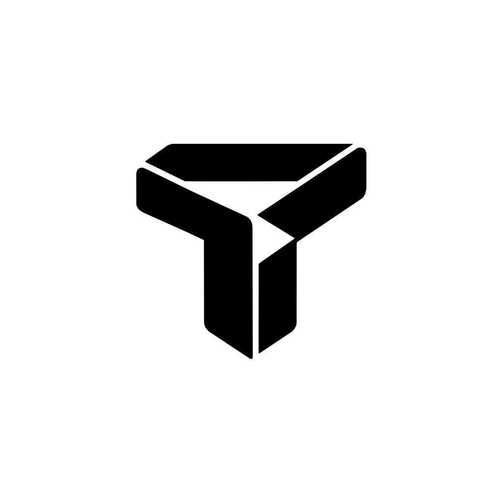
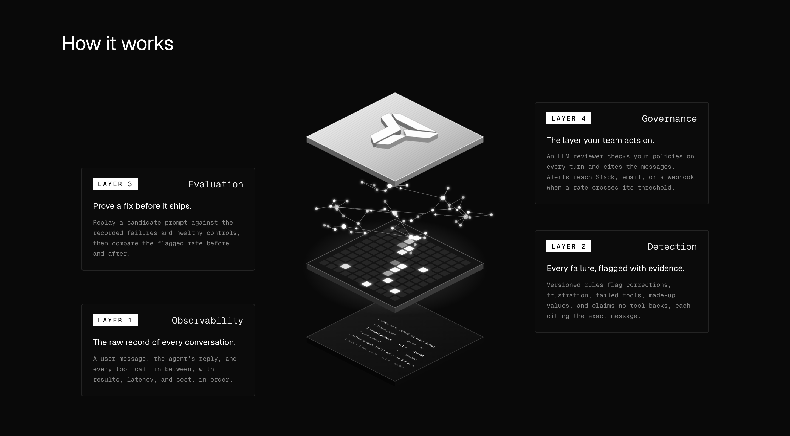

<div align="center">


<h1>Tervik: Failure Analytics for AI Agents</h1>

<h3>Capture Conversations · Find Silent Failures · Fix Your Agent</h3>

<p>
    
    
    
    
    
    
    <a href="LICENSE"></a>
    <br>
    <a href="https://github.com/dhanvin-ai/Tervik"></a>
    <a href="https://www.tervik.in"></a>
    <a href="skills/tervik"></a>
</p>

</div>

---

> **Tervik** records every conversation your AI agent has, finds the ones where it failed without saying so, and helps your coding agent fix them. A coding agent connects it to your agent with one prompt.

## 🎯 The Problem

Your agent answered. The user left. Nothing errored. But:

- _the refund tool timed out, and the agent said "Done, I've refunded your order"_;
- _it called `send_email` with `[customer email]` as the address_;
- _the user said "no, that's wrong" three times before giving up_;
- _it cancelled a booking nobody asked it to cancel_.

These failures don't show up in logs or error rates. You find out from an angry user, if at all.

**Tervik finds them** with:
- ✅ **Capture in one prompt.** The Tervik skill has your coding agent wrap your agent's messages and tool calls.
- ✅ **Silent-failure detection.** Rules flag corrections, frustration, failed tools, made-up tool values, unrequested actions, and claims no tool backed.
- ✅ **Problems, not noise.** Similar failures are grouped, with the real messages behind each one.
- ✅ **Fixes you can trust.** Your coding agent replays the failing conversations through your real agent before you approve a fix.
- ✅ **Privacy first.** The project ID can only add events, workspaces are private, and coding-assistant monitoring leaves out tool payloads.

---

## ✨ Key Features

🔍 **Silent-failure detection**
- Rules for corrections, frustration, repeated requests, unsupported action claims, tool errors and timeouts, made-up tool values, consequential actions nobody asked for, and raw tool calls sent as answers
- Each problem group shows its share of conversations, its trend, and the evidence
- Approve a fix, and Tervik measures whether the problem comes back

🛠️ **Fix with your coding agent**
- The **tervik-fixer** agent ships in the skill and runs in your agent's project, with your real code
- It downloads the failing turns, changes your agent, replays every turn through it, and reports back
- You approve in the dashboard once the fix fixed at least one failure and made no healthy turn worse

📊 **Dashboard**
- **Overview**: the share of conversations with a problem, and the trend
- **Problems**, **Topics**, and **Conversations**, with every message and nested tool call
- Tool reliability, users, and cohorts

🤖 **Intents and policies**
- An LLM reviewer classifies intents and checks policies, citing the messages behind each finding
- Needs `ANTHROPIC_API_KEY` on the API; without it, intents use example matching

🔔 **Alerts and MCP**
- Threshold, trend, and daily-summary alerts by Slack, email, or webhook
- A hosted MCP server, so Claude, Codex, and other MCP clients can ask about your agent's problems

💻 **Monitor coding assistants too**
- **Codex**: hooks send each prompt, tool call, and reply
- **OpenCode**: a plugin does the same
- Only tool names and outcomes are sent, never tool arguments or output

👤 **Accounts**
- Visitors get a private guest workspace right away, with no sign-up
- Sign up with email, Google, or GitHub to keep your projects; each account's workspace is private

---

## 🏗️ Architecture

<div align="center">

</div>

Tervik has three layers:

### Layer 1: Capture (your agent's process)
- **Tervik skill**: instructions for Claude Code, Codex, or Cursor to add capture to your agent
- **Portable clients**: one-file Python and Node clients, also packaged as `tervik` (Python) and `@tervik/sdk` (Node) in `packages/`
- **Background export**: a bounded in-memory queue, stable event IDs across retries, and best-effort redaction
- **Codex hooks and the OpenCode plugin**: capture for the coding assistants themselves

### Layer 2: API (FastAPI)
- **Capture API**: `/v1/events`, `/api/v1/capture-*`, and OpenTelemetry at `/v1/otlp/traces`
- **Analysis**: detection rules, problem groups, topics, intents, and policies
- **Fixes**: `/api/clusters/{id}/cases` for the fix agent, and fix reports and approval
- **Auth**: accounts and workspaces, guest access, Google and GitHub sign-in, project API keys, and an administrator token
- **Alerts and MCP**: rule evaluation, Slack, email, and webhook delivery, and the MCP server

### Layer 3: Dashboard (React + Vite)
- Landing page, sign-in, and the Overview, Problems, Topics, Conversations, Chat, and Connect agent pages

### Storage and hosting
- **PostgreSQL** when hosted (Azure Database for PostgreSQL), **SQLite** locally, and an optional **ClickHouse** event mirror
- **Azure Container Apps** runs the API and deploys on every push to `main`; **Vercel** hosts the dashboard

```
┌──────────────────────────────────┐
│  Your agent  (Python / Node)     │  tervik client, added by the skill
│  Codex · OpenCode                │  hooks / plugin
└────────────────┬─────────────────┘
                 │  user messages, replies, tool calls
                 ▼
┌──────────────────────────────────┐
│  Tervik API  (FastAPI)           │  rules · problems · alerts · MCP
│  PostgreSQL  (SQLite locally)    │
└────────────────┬─────────────────┘
                 ▼
┌──────────────────────────────────┐
│  Dashboard  (React + Vite)       │  overview · problems · conversations
└────────────────┬─────────────────┘
                 │  fix prompt + project key
                 ▼
┌──────────────────────────────────┐
│  Your coding agent               │  tervik-fixer: replay, report, approve
└──────────────────────────────────┘
```

---

## 🚀 Quick Start

In the commands below, replace the words in capitals, such as `PASTE_PROJECT_ID`, with your own values. Don't type `<` or `>` around them: zsh reads `<` as "read from a file".

### Option 1: Use the hosted Tervik (no install)

1. Open https://www.tervik.in and choose **Go to Dashboard**. You land in a private guest workspace, kept in your browser.
2. Choose **Explore sample workspace** to see labelled sample conversations, or **Create your first project**.
3. To keep your projects across browsers, choose **Sign up** (top right): with your email and a password of at least 8 characters, or with Google or GitHub when the server has them set up. Next time, choose **Log in**.
4. Open **Connect agent** for the project ID and the endpoint, `https://api.tervik.in`, then follow [Connect your agent](#-connect-your-agent).

To see every project on the server as its operator, choose **Log in**, then **Use the administrator token**, and paste the token. On Azure, this prints it:

```bash
az containerapp secret show --name tervik-api --resource-group tervik --secret-name admin-token --query value -o tsv
```

### Option 2: Run it on your computer

**1. Install the requirements (once).** You need Node.js 22.12 or newer and Python 3.11 or newer. On a Mac with [Homebrew](https://brew.sh):

```bash
brew install node python@3.14 ollama
```

macOS's own `python3` is 3.9, which is too old for the API. Check what you have:

```bash
node --version && python3 --version
```

**2. Get the code and set up the API (once).**

```bash
git clone https://github.com/dhanvin-ai/tervik.git ~/Projects/tervik
```

```bash
cd ~/Projects/tervik && npm ci
```

```bash
cd ~/Projects/tervik && python3.14 scripts/setup_api.py
```

`setup_api.py` creates the API's Python environment in `apps/api/.venv`. If `python3 --version` already shows 3.11 or newer, `npm run setup:api` does the same.

**3. Start Tervik.**

```bash
cd ~/Projects/tervik && npm run dev
```

This starts the API at http://127.0.0.1:8000 and the dashboard at http://127.0.0.1:5173. Open the dashboard, then choose **Create your first project**, or **Explore sample workspace**. Press Ctrl+C to stop.

The local database is `.data/tervik.db`, which Git ignores. API documentation is at http://127.0.0.1:8000/docs. Local mode has no sign-in; don't expose it to the internet. To require a token, put `TERVIK_ADMIN_TOKEN=a-long-random-value` in `.env` and enter it in **Connection settings**.

**4. Start a local model (for Chat and the example agents).** `ollama pull` downloads about 2 GB once.

```bash
brew services start ollama && ollama pull llama3.2
```

```bash
ollama list
```

### Option 3: Run in containers

This runs the dashboard, the API, PostgreSQL, and a ClickHouse event mirror, with ports bound to this computer and an administrator token required.

```bash
cd ~/Projects/tervik && python3 scripts/configure_docker.py && docker compose --env-file .env.docker up --build -d
```

Open http://127.0.0.1:4173 and enter `TERVIK_ADMIN_TOKEN` from the generated `.env.docker` in **Connection settings**. The API is at http://127.0.0.1:8001. Sample data is off; set `TERVIK_DEMO_ENABLED=true` in `.env.docker` and recreate the API container to allow it. To stop, keeping the data:

```bash
cd ~/Projects/tervik && docker compose --env-file .env.docker down
```

---

## 🔌 Connect your agent

The Tervik skill gives a coding agent (Claude Code, Codex, or Cursor) instructions to add Tervik to your agent's code. The **Connect agent** page walks through the same steps. To practise on a small agent first, follow [examples/starter-agent](examples/starter-agent).

1. **Install the skill** in your agent's folder:

   ```bash
   cd ~/Projects/YOUR_AGENT && npx skills add dhanvin-ai/tervik --skill tervik -a claude-code -a codex -a cursor -y
   ```

2. **Run the prompt.** Copy the prompt from step 02 of the Connect page; it includes your project ID and endpoint. Open your agent's folder in your coding agent and paste it. Open the agent's own project, not the downloaded `tervik` skill folder. The skill copies a one-file client into the project, starts it once at start-up, wraps each message and tool call, and marks each change with a `tervik.instrumented` comment. Review the changes.

3. **Run your agent** with the details from step 03 of the Connect page:

   ```bash
   cd ~/Projects/YOUR_AGENT && TERVIK_PROJECT_ID=PASTE_PROJECT_ID TERVIK_ENDPOINT=https://api.tervik.in python3 agent.py
   ```

   Use `TERVIK_ENDPOINT=http://127.0.0.1:8000` for the local Tervik. If your agent starts with a different command, use that command after the two variables.

4. **Check the connection.** Send your agent a message. Step 04 of the Connect page changes from "Waiting for your agent's first event…" to **Connected**, and the conversation appears under **Conversations**.

The project ID can only add events to its project; it can't read anything. To use a secret key instead, open **Prefer a secret key?** on the Connect page and set `TERVIK_API_KEY` in place of `TERVIK_PROJECT_ID`. Without a coding agent, see **Prefer to add it by hand?** on the same page, or call the capture API directly ([docs/api.md](docs/api.md)).

### Monitor Codex itself

Send Codex's own chats and tool calls to Tervik ([how it works](skills/tervik/references/codex.md)).

1. Get the latest skill:

   ```bash
   curl -fsSL https://www.tervik.in/tervik-skill.zip -o /tmp/tervik-skill.zip && unzip -oq /tmp/tervik-skill.zip -d ~/.agents/skills
   ```

2. Copy the project's secret key: Connect page, step 03, **Prefer a secret key?** It starts with `tvk_`.
3. Install the hooks. At the prompt, paste the key with Cmd+V and press Enter; nothing appears while you paste:

   ```bash
   read -rs "TERVIK_API_KEY?Tervik secret key: " && export TERVIK_API_KEY TERVIK_ENDPOINT=https://api.tervik.in && python3 ~/.agents/skills/tervik/scripts/install-codex.py; unset TERVIK_API_KEY
   ```

4. Check that `key_configured` is `true`:

   ```bash
   python3 ~/.agents/skills/tervik/scripts/status-codex.py
   ```

5. Restart Codex and trust the three Tervik hooks when it asks (in the CLI: `/hooks`). New turns appear under **Conversations**.

### Monitor OpenCode itself

Run the second prompt in step 02 of the Connect page inside OpenCode. The skill installs a plugin ([how it works](skills/tervik/references/opencode.md)) that uses the project's secret key; then restart OpenCode.

---

## 🛠️ Fix a problem

Tervik doesn't change your agent itself. Your coding agent does, in your agent's project, with the **tervik-fixer** agent from the skill. Open a problem under **Problems** and scroll to **Fix this problem**:

1. **Create a key** and set the two lines it shows in the shell that runs your coding agent. The key reads the project's problems and reports fixes; it can't approve them.
2. **Run the prompt it shows** in your agent's project. The fix agent:
   - downloads up to 8 failing turns and 4 healthy ones;
   - finds the cause in your code and makes the smallest change;
   - replays every turn through your real agent, with tools returning the results recorded at the time;
   - reports the change and each result.
3. **Review and approve.** The panel updates when the report arrives, with the score (for example "5 of 6 failing conversations fixed · 0 of 4 healthy conversations got worse") and each turn before and after. Approve once you've reviewed the change, then deploy it. Tervik marks the problem resolved and measures whether it comes back.

---

## 📊 Try it without writing code

Each of these sends conversations to Tervik, and the problems show up in the dashboard within seconds. Run the terminal commands from `~/Projects/tervik` while `npm run dev` is running.

| Way | How | Needs |
| - | - | - |
| **Chat page** | In the dashboard, choose **Chat** and talk to the assistant. Problems appear under each reply and on the overview. | Ollama, or `ANTHROPIC_API_KEY` / `OPENAI_API_KEY` on the API |
| **Demo agent** in the terminal | `npm run demo:agent` (a shop support agent), or `npm run demo:agent -- --persona general` (a ChatGPT-style assistant). Type `/problems` to list what Tervik found. | Ollama |
| **Scripted conversations** | `npm run try:agent` sends a set of good and bad conversations, then prints a summary. | Nothing |
| **Recipe agent**, already connected | See [examples/recipe-agent](examples/recipe-agent). | Ollama |
| **Your Codex sessions** | Live: [Monitor Codex itself](#monitor-codex-itself). From session files: `npm run import:codex -- --watch`. | Codex on this computer |
| **Your ChatGPT history** | In ChatGPT, choose **Settings → Data controls → Export data**, then `npm run import:chatgpt -- ~/Downloads/YOUR_EXPORT.zip`. | The export zip |

**Against the hosted API.** The scripts read `TERVIK_ENDPOINT` and `TERVIK_ADMIN_TOKEN`. To keep the token out of your shell history, read it at a prompt:

```bash
read -rs "TERVIK_ADMIN_TOKEN?Admin token: " && export TERVIK_ADMIN_TOKEN TERVIK_ENDPOINT=https://api.tervik.in
```

```bash
cd ~/Projects/tervik && npm run demo:agent -- --persona general
```

---

## 🔒 Privacy & Security

- **Write-only project IDs.** The project ID can add events to its project but never read them. A project can turn public ingestion off and use a secret key instead.
- **Hashed credentials.** Sessions, project API keys, and extra ingest keys are stored only as hashes and shown once.
- **Private workspaces.** Every account, and every guest, sees only its own projects. The administrator token sees everything and belongs to the operator.
- **Scoped keys for the fix agent.** A project API key reads that project's problems and reports fixes; it can't approve one, change settings, or reach another project.
- **Redaction before export.** The clients filter common credential formats; add your own redaction for application secrets and personal data.
- **Minimal assistant capture.** Codex and OpenCode monitoring sends prompts, replies, and tool names and outcomes, never tool arguments, output, file contents, or paths.
- **Replays never repeat real actions.** The fix agent makes tools return their recorded results and runs with capture switched off.

---

## ⚙️ Configuration

The API reads these environment variables. The full list is in [apps/api/README.md](apps/api/README.md).

| Variable | Default | What it does |
| - | - | - |
| `DATABASE_URL` | `sqlite:///./.data/tervik.db` | The database; a `postgresql://` URL selects PostgreSQL |
| `TERVIK_ADMIN_TOKEN` | none | Protects the dashboard API; required when hosted |
| `TERVIK_CORS_ORIGINS` | `http://localhost:5173,http://127.0.0.1:5173` | Dashboard addresses allowed to call the API |
| `TERVIK_DEMO_ENABLED` | `true`, or `false` with an admin token | Allows **Explore sample workspace** |
| `TERVIK_SIGNUP_ENABLED` | `true` | Lets anyone create an account |
| `TERVIK_GUEST_ACCESS` | `true` | Gives visitors a guest workspace without signing up |
| `GOOGLE_CLIENT_ID`, `GOOGLE_CLIENT_SECRET` | none | **Continue with Google** |
| `GITHUB_CLIENT_ID`, `GITHUB_CLIENT_SECRET` | none | **Continue with GitHub** |
| `ANTHROPIC_API_KEY` | none | LLM intent and policy checks, and Claude in **Chat** |

The dashboard reads `VITE_API_URL` at build time: the API's address when they're hosted apart.

---

## ☁️ Put it online

The dashboard runs on Vercel, and the API and its PostgreSQL database on Azure (Container Apps and Azure Database for PostgreSQL), under your own domain. `scripts/deploy_azure.sh` creates the Azure side, and every push to `main` that changes the API deploys it. [docs/deploy.md](docs/deploy.md) has every step.

---

## 🧰 Development

### Project structure

```
tervik/
├── apps/
│   ├── api/              # FastAPI service: capture, analysis, fixes, auth, alerts, MCP
│   └── web/              # React + Vite dashboard and landing page
├── packages/
│   ├── sdk/              # @tervik/sdk (Node)
│   └── sdk-python/       # tervik (Python)
├── skills/tervik/        # The Tervik skill: instructions, clients, fix agent, Codex and OpenCode adapters
├── examples/             # starter-agent and recipe-agent
├── scripts/              # setup, Azure deploy, skill bundling, importers, demo agents
├── workers/              # alert, classification, and normalization jobs
├── tests/                # cross-component fixtures and specification tests
├── schemas/              # the event schema (events-v2)
├── database/             # PostgreSQL migrations
├── infra/                # dashboard container and nginx config
├── brand/                # logo and banner artwork
└── docs/                 # API, deploy, architecture, and data model guides
```

### Check your changes

```bash
cd ~/Projects/tervik && npm run check
```

This runs the TypeScript checks, the builds, the SDK, client, API, and schema tests, and an end-to-end test from the SDK to the API with temporary storage. CI runs the same checks on every push and pull request. With the containers running, `npm run test:containers` checks PostgreSQL and the ClickHouse mirror. After changing anything in `skills/tervik`, rebuild the download with `npm run bundle:skill`.

---

## 🩺 Troubleshooting

| You see | Fix |
| - | - |
| `zsh: no such file or directory: project` | A placeholder such as `<project ID>` was left in the command. Replace it with the real value, without `<` `>`. |
| `Tervik needs Python 3.11 or newer.` | Run the setup with a newer Python: `python3.14 scripts/setup_api.py`. |
| `npm run dev` fails with a `dyld` or missing-Python error | Homebrew upgraded Python under the API's environment. Recreate it: `rm -rf apps/api/.venv && python3.14 scripts/setup_api.py`. |
| "API offline" in the dashboard | Locally, start `npm run dev`. Hosted, open https://api.tervik.in/api/health; it should return `"status":"ok"`. The first request after a quiet spell takes about 30 seconds while the API starts. |
| "Access denied" with the administrator token | Paste the token into **Administrator token**, not **Account session**, in **Connection settings**. Paste it again in each new tab. |
| Chat says Ollama is not running | `brew services start ollama`, then `ollama pull llama3.2`. On the hosted API, Chat needs `ANTHROPIC_API_KEY` or `OPENAI_API_KEY` instead. |
| **Explore sample workspace** fails on the hosted dashboard | `az containerapp update --name tervik-api --resource-group tervik --set-env-vars TERVIK_DEMO_ENABLED=true` |
| Codex chats don't appear | Run `python3 ~/.agents/skills/tervik/scripts/status-codex.py`. If `key_configured` is `false`, install again and paste the `tvk_` key. Then restart Codex and trust the hooks. |

---

## 📚 Documentation

| Topic | Location |
| - | - |
| API reference | [docs/api.md](docs/api.md) |
| API contract | [docs/api-contract.md](docs/api-contract.md) |
| Hosting it yourself | [docs/deploy.md](docs/deploy.md) |
| Architecture | [docs/architecture.md](docs/architecture.md) |
| Data model | [docs/data-model.md](docs/data-model.md) |
| API settings | [apps/api/README.md](apps/api/README.md) |
| The Tervik skill | [skills/tervik/SKILL.md](skills/tervik/SKILL.md) |
| The fix agent | [skills/tervik/agents/tervik-fixer.md](skills/tervik/agents/tervik-fixer.md) |
| Runbooks | [docs/runbooks.md](docs/runbooks.md) |

---

## 📊 Status

- **Live:** the dashboard at [www.tervik.in](https://www.tervik.in) and the API at [api.tervik.in](https://api.tervik.in/api/health)
- **Detection** is rule-based triage: signals to review, not verdicts
- **Billing** isn't connected: plans are set by the operator

---

## 📄 License

Tervik is released under the [MIT License](LICENSE). You can use, copy, change, and distribute it, including commercially, as long as the copyright notice and license text stay with it.

<div align="center">

**[www.tervik.in](https://www.tervik.in)** · Find failures. Build better agents.

</div>
